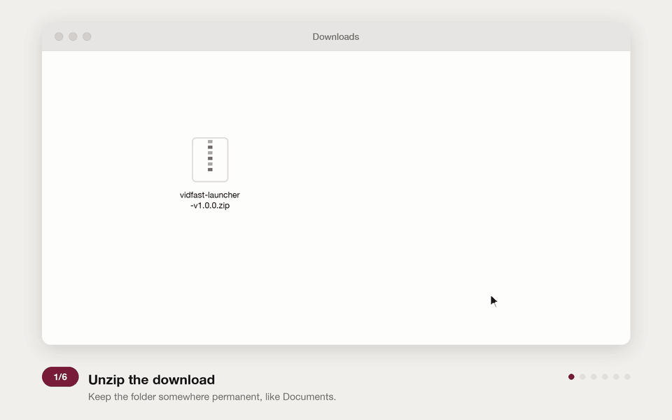

# VidFast launcher

A small Chrome extension: on any IMDb title page, click the toolbar icon and the title opens in VidFast in a new tab. It remembers your last five titles and picks shows up where you left off.

## Install

1. Download `vidfast-launcher-v1.0.0.zip` from the [latest release](https://github.com/siddharthaasal/imdb-to-vidfast/releases/latest) and unzip it somewhere permanent, for example `Documents/vidfast-launcher`.
2. Open `chrome://extensions` and turn on **Developer mode** (top right).
3. Click **Load unpacked** and select the unzipped `vidfast-launcher` folder.
4. Click the puzzle-piece icon in the toolbar and pin **VidFast launcher**.

Don't delete or move the folder afterwards: Chrome loads the extension from it, and removes the extension if the folder disappears.

## Use

| Where you are | What the icon does |
|---|---|
| A movie page on IMDb | Opens the movie |
| A show's main page | Opens S1 E1, or the last episode you opened for that show |
| An episode page | Opens that exact episode |
| Any other website | Shows your five most recent titles; click one to reopen it, × to remove it |
| IMDb people, lists, video games, podcasts | Nothing (the icon is greyed out) |

On IMDb, **right-click** the icon to reach your recent titles.

A **?** on the icon means the extension couldn't read the season or episode number. It opens the show at S1 E1 instead.

History stays in your browser. Nothing is sent anywhere.

## Update

1. Download the new release zip and unzip it.
2. Replace the contents of your existing folder with the new files, keeping the same folder path.
3. On `chrome://extensions`, click the reload icon on VidFast launcher.

Keeping the same folder path keeps your history.

## Known limits

- **Season 0 specials:** these open the show at S1 E1 with a **?** badge.
- **IMDb's episode-list pages** (`/episodes/?season=3`): these open the show, not that season.
- **Switching episodes inside VidFast:** history doesn't see it, so it keeps the episode you launched.
- **Browsers:** tested on desktop Chrome only. Other Chromium browsers (Brave, Edge, Arc) should work with the same steps.

## Development

Plain JavaScript with no build step: edit the files, then reload the extension on `chrome://extensions`.

| File | Purpose |
|---|---|
| `manifest.json` | Extension manifest (Manifest V3) |
| `background.js` | Icon click, per-tab icon behaviour, right-click menu |
| `detect.js` | Reads the title ID, type, series, season and episode from an IMDb page |
| `launch.js`, `recents.js` | Opening titles and the five-title history |
| `config.js` | The VidFast base URL, the only place it appears |
| `popup.html`, `popup.css`, `popup.js` | The recent-titles popup |
| `tools/make_icons.py` | Draws `icons/` (`python3 tools/make_icons.py`; edit colours and shapes at the top) |
| `tools/make_install_gif.py` | Draws `docs/install.gif`, the illustrated install walkthrough (needs Pillow: `pip install pillow`) |

`plan.md` is the build list and its progress.
